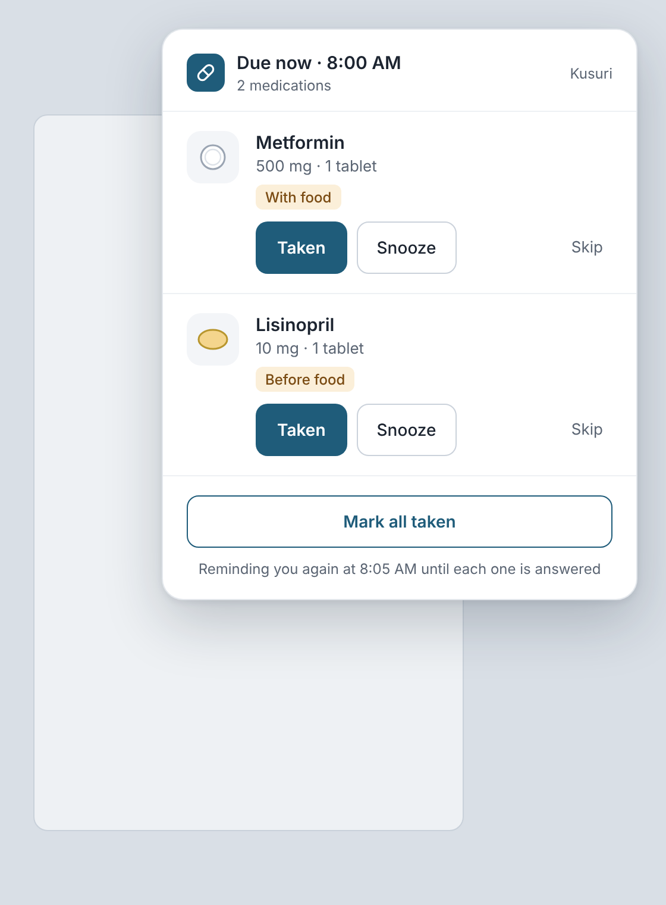
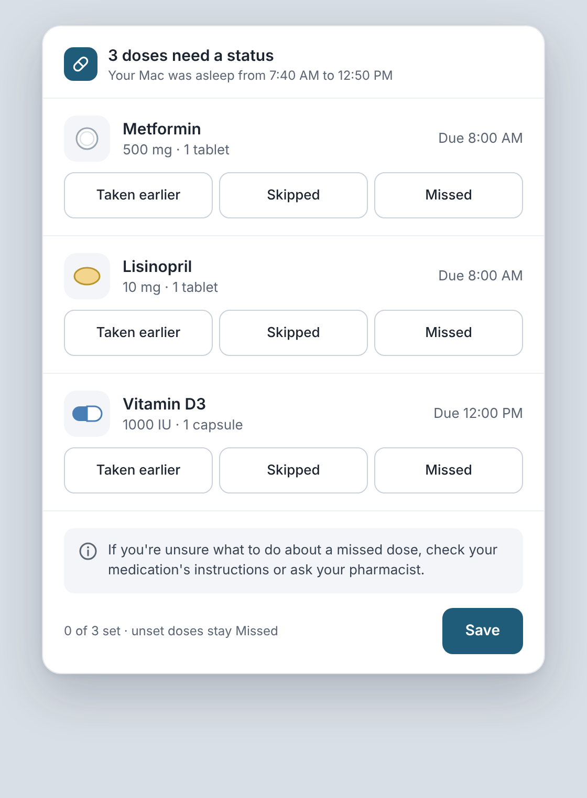
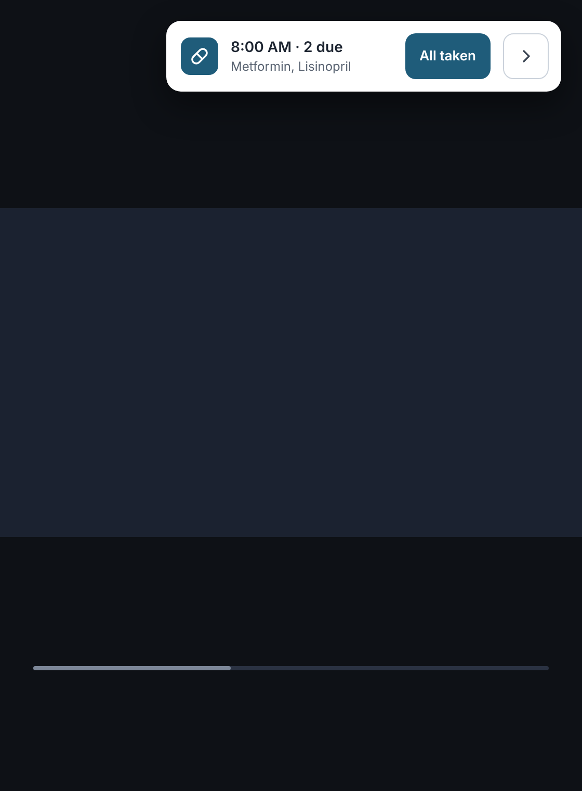

# Design

Early designs for Kusuri v1's three main screens. The demo uses example medications only.

> The logo and colour scheme are temporary placeholders and will change as the design develops.

---

## Reminder card

The card that appears at each dose time. It floats above every app and stays on screen until each medication has a status.

- **One card per time slot.** Medications due at the same time are grouped together, here two at 8:00 AM.
- **Each row shows** the medication name, dose, a shape-and-colour graphic so it's easy to recognise, and the user's own food instruction.
- **Taken** is the primary action. **Snooze** hides the card briefly. **Skip** is deliberately small and grey, but never blocked. Skipping opens an optional "Why?" with four reasons.
- **Mark all taken** answers the whole slot in one tap. Each row can still be answered on its own.
- **Escalation.** If nothing is pressed, the card re-raises itself every 5 minutes, then every 10, and logs the dose as Missed after 60 minutes. Snoozing never extends that hour.

---

## Batch update

Opens automatically when the Mac wakes or unlocks and doses passed without an answer. The user doesn't need to open Kusuri first.

- Lists every unanswered dose with its graphic, dose and due time. Here, two at 8:00 AM and one at 12:00 PM.
- Each dose gets one of three honest statuses: **Taken earlier**, **Skipped** or **Missed**. Any left unset are saved as Missed.
- It only records what happened. It never suggests taking a dose now, and it always shows: *"If you're unsure what to do about a missed dose, check your medication's instructions or ask your pharmacist."*

---

## Compact card

A smaller, quieter version shown when an app is in full screen, such as a video or a presentation.

- A single line: the time, how many doses are due, and which medications.
- **All taken** answers the slot without leaving full screen. The arrow opens the full card.
